<div align="center">


# MoneyPilot

**A full-stack personal finance app for tracking income, expenses, budgets and savings goals in one calm place.**

[](https://github.com/zekeriyacindemir/MoneyPilot/actions/workflows/ci.yml)


🚀 **Live demo:** coming soon (deployment in progress)

</div>

---

## Overview

MoneyPilot helps people see where their money goes and plan their next step. Users record income and
expenses in several currencies, set monthly budgets per category, track savings goals, automate
recurring payments, and get monthly reports, a financial health score and rule-based daily coaching.
Budget and goal alerts arrive both in the app and by email.

The project is a TypeScript monorepo with a **Next.js** front end and a **NestJS + Prisma + PostgreSQL**
REST API. It ships with end-to-end tests, a CI pipeline and a self-hosted Docker production stack.
The interface is in Turkish.

<p align="center">
  
</p>

## Screenshots

### Dashboard: dark and light themes

| Dark                                                          | Light                                                           |
| ------------------------------------------------------------- | --------------------------------------------------------------- |
| 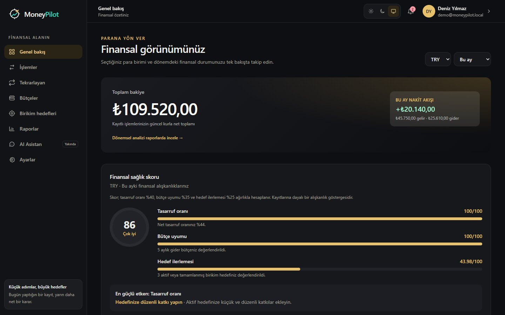 | 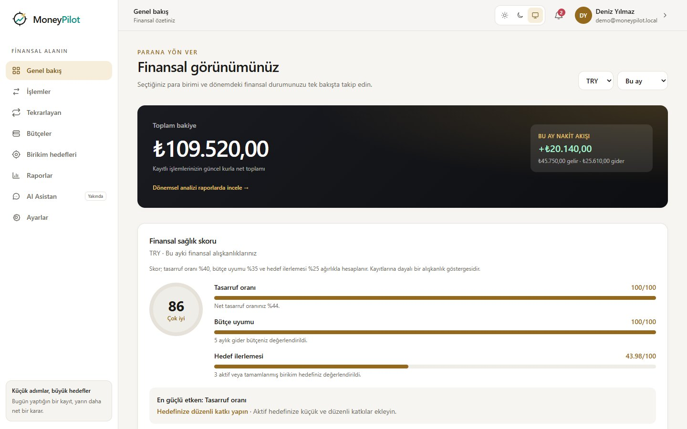 |

### Everyday tools

| Transactions                                                          | Budgets                                               |
| --------------------------------------------------------------------- | ----------------------------------------------------- |
| 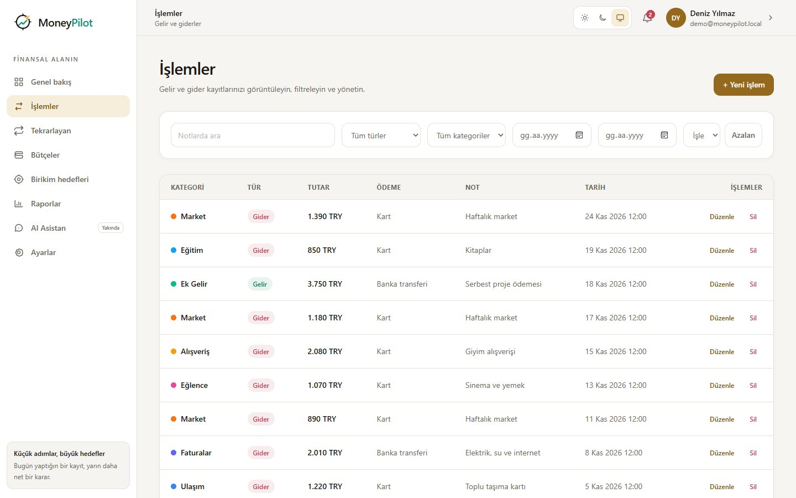 | 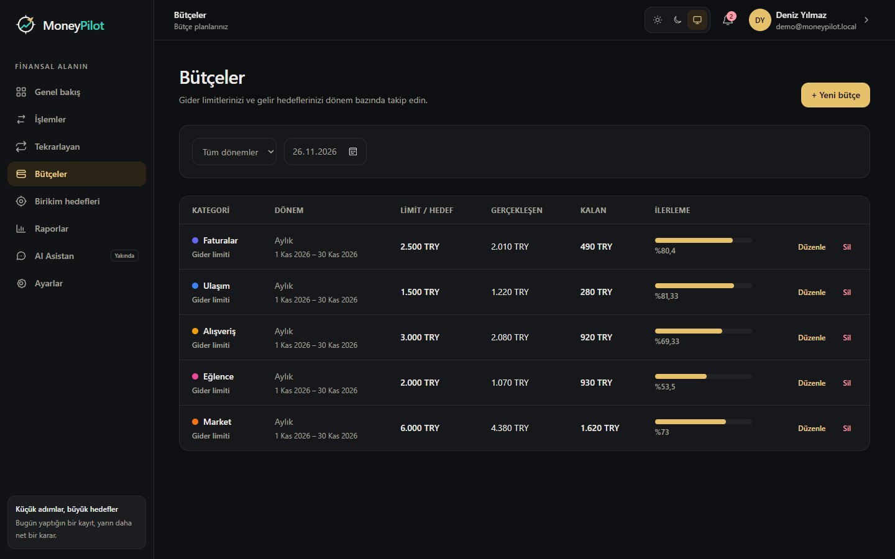 |
| **Savings goals**                                                     | **Reports**                                           |
| 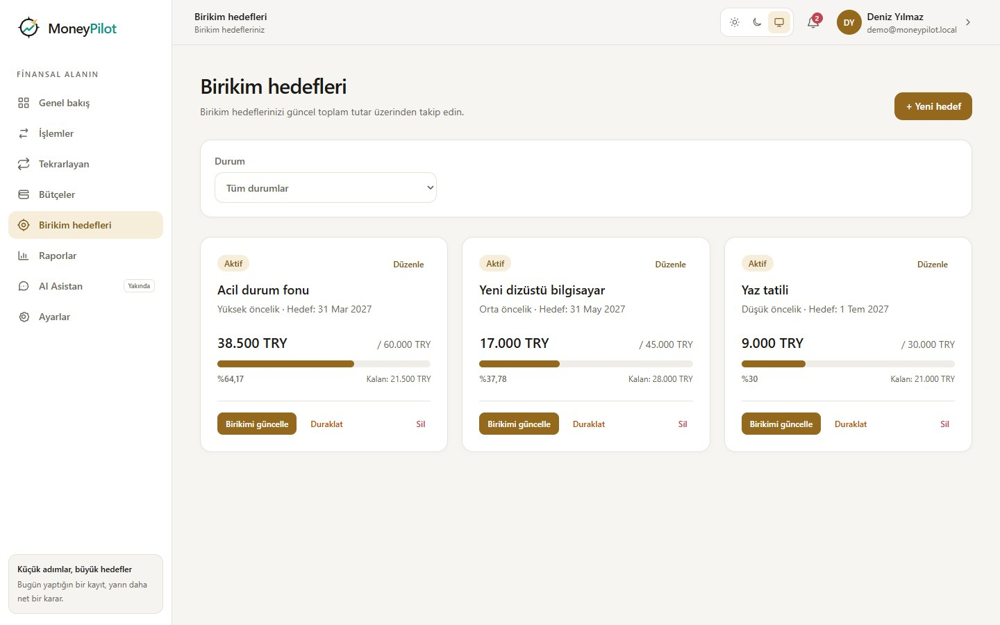                  | 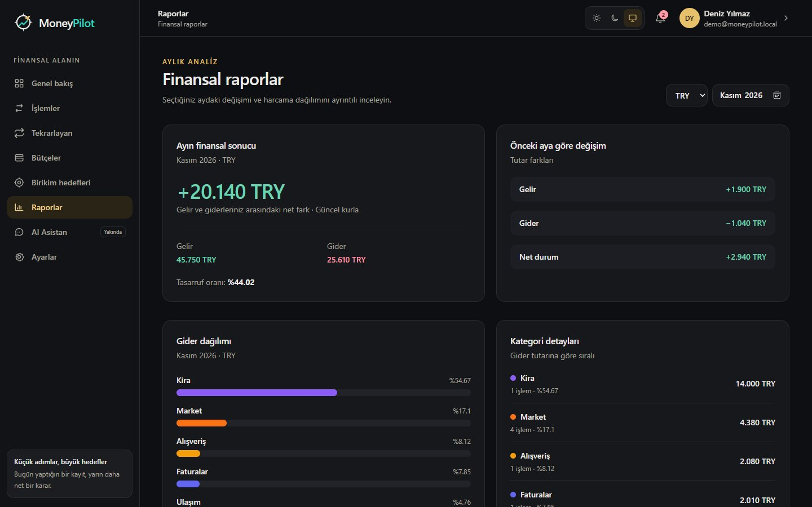 |
| **Recurring transactions**                                            | **Sign up**                                           |
| 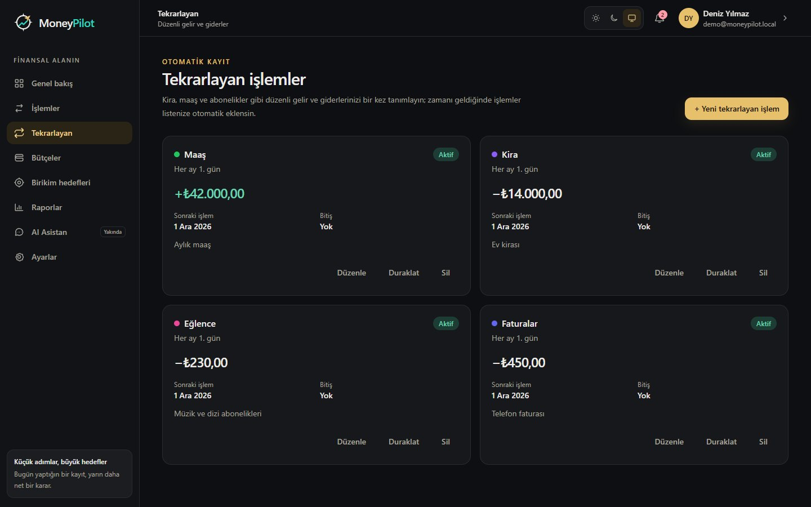        | 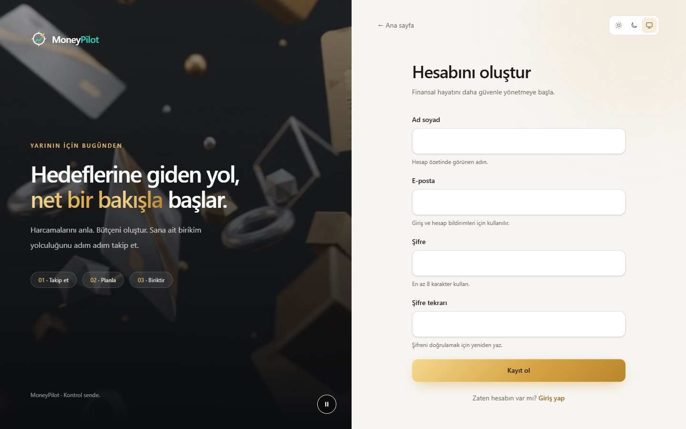   |

### Landing page and mobile

<p align="center">
  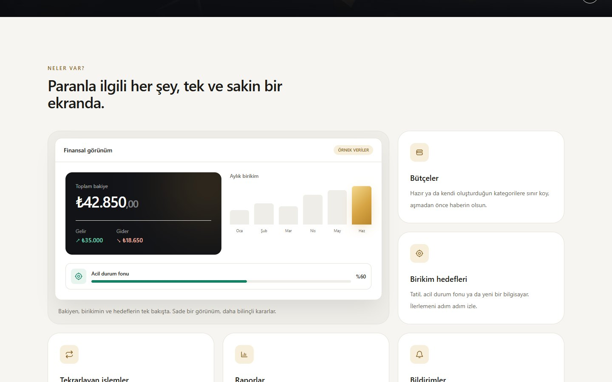
</p>
<p align="center">
  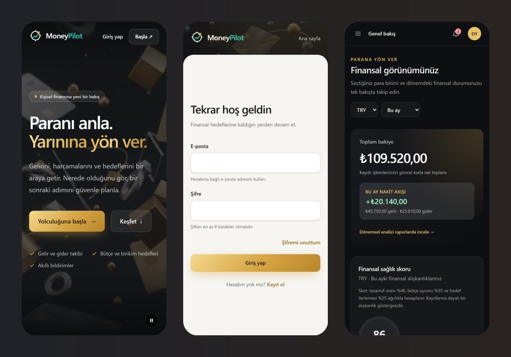
</p>

## Features

- **Transactions:** income and expense records with filters, search, notes and payment methods. Amounts can be in TRY, USD, EUR or GBP, and totals are converted at live exchange rates.
- **Categories:** ready-made income and expense categories, plus custom ones with your own colors.
- **Budgets:** monthly limits per category with progress bars, and warnings before you go over.
- **Savings goals:** target amount, target date and priority, with progress tracking.
- **Recurring transactions:** rent, salary and subscriptions defined once and posted weekly, monthly or yearly.
- **Reports:** monthly result, change against the previous month, and spending by category.
- **Financial health score and coaching:** a weighted score (savings rate, budget adherence, goal progress) with rule-based daily tips.
- **Notifications:** budget, goal-deadline, goal-completed and weekly-summary alerts in the app and by email.
- **Accounts and security:** registration, login, password reset by email, session management, and per-user preferences.
- **Design:** responsive layout, light, dark and system themes, and a charcoal-and-gold brand built around the hero video.

## Tech stack

| Layer     | Technologies                                                                                                |
| --------- | ----------------------------------------------------------------------------------------------------------- |
| Front end | Next.js 16 (App Router), React 19, TypeScript, Tailwind CSS 4, TanStack Query, Axios                        |
| Back end  | NestJS 11, Prisma 6, PostgreSQL 16, class-validator, Swagger / OpenAPI                                      |
| Auth      | JWT access tokens with rotating refresh tokens in HTTP-only cookies, Argon2 password hashing, rate limiting |
| Email     | Nodemailer over SMTP with TLS                                                                               |
| Testing   | Jest unit tests and end-to-end tests against a real PostgreSQL database                                     |
| DevOps    | Docker, Docker Compose, GitHub Actions, a database backup script                                            |

## Architecture

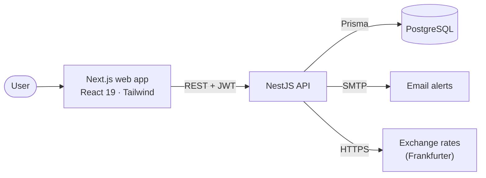

```
moneypilot/
├── apps/
│   ├── web/          # Next.js front end (app router, features/*, theme tokens)
│   └── api/          # NestJS API (auth, transaction, budget, savings-goal, recurring-transaction,
│                     #   reports, dashboard, notification) + Prisma schema and migrations
├── docker/           # Production Dockerfiles for the web app and the API
├── scripts/          # Database backup script
├── compose.yaml      # Local PostgreSQL
└── compose.prod.yaml # Self-hosted production stack
```

## Engineering highlights

- **Tested API:** end-to-end suites cover auth, categories, dashboard, notifications and financial
  reliability (money math and currency handling), plus unit tests for recurrence rules.
- **CI on every push:** install, migrate, a schema drift check, tests, Prettier, ESLint, type checks,
  production builds, and Docker image builds.
- **Security by default:** strict Content-Security-Policy and security headers, HTTP-only refresh
  cookies, Argon2 hashing, login rate limiting, and validated DTOs on every endpoint.
- **Production-ready setup:** multi-stage Docker images, a separate migrations image, proxy-aware
  logging, and a backup script that verifies each dump and prunes old ones.
- **Accessibility and performance:** the hero video plays only while on screen, has a pause button,
  and falls back to a still image for reduced-motion or data-saver users.
- **SEO:** per-page metadata, Open Graph share images, `sitemap.xml`, `robots.txt`, a web manifest and
  structured data.

## Getting started

**Requirements:** Node.js 20.19, npm 10+, Docker Desktop

```bash
# 1. Environment files
cp apps/api/.env.example apps/api/.env
cp apps/web/.env.example apps/web/.env.local

# 2. Install dependencies and start PostgreSQL
npm install
docker compose up -d postgres

# 3. Apply migrations and seed default categories
npx prisma migrate deploy --schema apps/api/prisma/schema.prisma
npm run prisma:seed --workspace=@moneypilot/api

# 4. Run the API and the web app (in separate terminals)
npm run dev:api
npm run dev:web
```

- Web app: http://localhost:3000
- API health check: http://localhost:3001/health
- API docs (Swagger, development only): http://localhost:3001/docs

See [operations](docs/operations.md) for tests, SMTP setup and release preparation.

## Roadmap

- [x] Transactions, categories, budgets and savings goals
- [x] Recurring transactions and opening balance
- [x] In-app and email notifications
- [x] Reports, financial health score and rule-based coaching
- [x] Production hardening and Docker production stack
- [x] Brand redesign, dark mode and SEO
- [ ] **Public deployment and live demo**
- [ ] AI assistant on top of the existing coaching rules

## Author

Built by [Zekeriya Cindemir](https://github.com/zekeriyacindemir).
